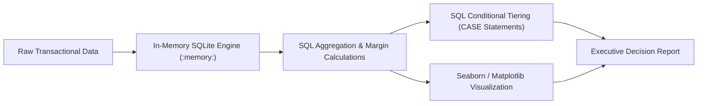

# Retail Sales & Profit Margin Analytics Engine

[](https://www.python.org/)
[-003B57?logo=sqlite&logoColor=white)](https://www.sqlite.org/)
[](https://pandas.pydata.org/)
[](LICENSE)
[](https://github.com/TulsankarAaryan)

An end-to-end SQL & Python analytical pipeline built with an in-memory SQLite database. It computes sub-category profit margins, evaluates revenue distribution, renders profitability-weighted heatmaps, and dynamically tags operational tiers using SQL conditional subqueries.

---

## 📌 Executive Summary

Organizations often struggle to balance top-line sales volume against bottom-line margin realization. High revenue product lines may conceal negative profit contributions. 

This project solves this operational visibility problem by:
1. **Executing In-Memory SQL Pipelines:** Eliminates database infrastructure overhead by running analytical queries directly in-memory via Python's native `sqlite3`.
2. **Sub-Category Margin Quantification:** Evaluates revenue against realized net profits with floating-point margin calculations.
3. **Automated Tier Classification:** Uses nested SQL subqueries and `CASE` statements to tag items into actionable business tiers (**High Performer**, **Stable**, **Review Required**).
4. **Visual Performance Reporting:** Generates high-resolution Seaborn and Matplotlib charts mapping sales against profitability color scales.

---

## 🛠️ Architecture & Pipeline



---

## 🧮 Analytical Methodology

### 1. Margin Percentage Calculation
$$\text{Margin Percentage} = \text{ROUND}\left(\frac{\text{CAST}(\text{SUM}(\text{Profit}) \text{ AS FLOAT})}{\text{SUM}(\text{Sales})} \times 100, 2\right)$$

### 2. Operational Performance Classification

| Performance Tier | Margin Condition | Strategic Action |
| :--- | :--- | :--- |
| 🟢 **High Performer** | $\text{Margin} > 10\%$ | Scale inventory, prioritize ad spend, protect stock levels. |
| 🟡 **Stable** | $0\% \le \text{Margin} \le 10\%$ | Maintain volume, evaluate minor price optimizations. |
| 🔴 **Review Required** | $\text{Margin} < 0\%$ | Audit supply chain cost, renegotiate vendor contracts, or deprecate line. |

---

## 📊 Dataset Schema

The in-memory `Sales_Data` table models enterprise transaction records:

| Field Name | Type | Description | Sample Values |
| :--- | :--- | :--- | :--- |
| `Order_ID` | `INTEGER` | Unique identifier for the order record | `1, 2, 3, 4` |
| `Category` | `TEXT` | Primary operational category | `Tech, Furniture, Office` |
| `Sub_Category` | `TEXT` | Specific product line segment | `Laptops, Phones, Chairs, Tables` |
| `Sales` | `NUMERIC` | Gross transaction revenue ($) | `1000, 2000, 1500` |
| `Profit` | `NUMERIC` | Net realized profit ($) | `250, 100, -100` |

---

## 🚀 Quickstart Guide

### Prerequisites
* Python 3.9 or higher
* Git

### Installation

1. **Clone the repository:**
   ```bash
   git clone https://github.com/TulsankarAaryan/sales-analytics-dashboard.git
   cd sales-analytics-dashboard
   ```

2. **Create and activate a virtual environment (optional but recommended):**
   ```bash
   python -m venv venv
   # On Windows:
   venv\Scripts\activate
   # On macOS/Linux:
   source venv/bin/activate
   ```

3. **Install dependencies:**
   ```bash
   pip install -r requirements.txt
   ```

4. **Run the analytics pipeline:**
   ```bash
   python sales_analytics.py
   ```

---

## 📈 Sample Output

```text
============================================================
  Retail Sales & Profitability Analytics Engine
  Author: Aaryan Tulsankar | GitHub: @TulsankarAaryan
============================================================
✓ Successfully loaded sales dataset into SQLite in-memory store.

--- Sub-Category Profit Margin Analysis ---
 Category Sub_Category  Total_Sales  Total_Profit  Margin_Percentage
     Tech      Laptops         2000           250              12.50
     Tech       Phones         1000           100              10.00
   Office        Paper          500            10               2.00
   Office         Pens          300             5               1.67
Furniture       Chairs         1500           -50              -3.33
Furniture       Tables         1200          -100              -8.33

--- Operational Tier Classification Report ---
Sub_Category  Total_Sales  Total_Profit  Margin_Percentage Performance_Status
     Laptops         2000           250              12.50     High Performer
      Chairs         1500           -50              -3.33    Review Required
      Tables         1200          -100              -8.33    Review Required
      Phones         1000           100              10.00             Stable
       Paper          500            10               2.00             Stable
        Pens          300             5               1.67             Stable

✓ Saved analytics chart to sales_performance_report.png
✓ Pipeline execution complete.
```

---

## 👤 Author

**Aaryan Tulsankar**  
* GitHub: [@TulsankarAaryan](https://github.com/TulsankarAaryan)  
* Email: [tulsankaraaryan@gmail.com](mailto:tulsankaraaryan@gmail.com)

---

## 📜 License

This project is licensed under the MIT License - see the [LICENSE](LICENSE) file for details.
